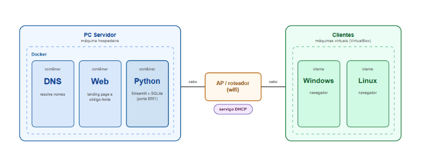

# Projeto Integrado: Sistema de Gestão de Delivery Local

## 1. Contexto do Problema
Uma empresa de delivery precisa de uma ferramenta para gerenciar suas operações (exemplo pedidos, produtos). Por políticas de segurança e restrições de permissão nas máquinas dos colaboradores, **não é permitido instalar softwares de terceiros ou bancos de dados pesados**.

A solução deve ser uma aplicação leve, desenvolvida internamente, que rode diretamente pelo interpretador Python e utilize apenas recursos nativos (como o banco de dados SQLite). Cada grupo escolherá um **nicho de mercado específico** (ex: Pizzaria, Comida Árabe, Sushi, Hamburgueria), o que definirá a identidade visual, o cardápio e as regras de negócio do sistema.

## 2. O Foco
O objetivo central é a **construção do sistema em Python**. As demais disciplinas atuarão como suporte para viabilizar, documentar, hospedar e distribuir esse produto final.

## 3. Papéis das Disciplinas

- **LOPAL:** Desenvolver a lógica do sistema em Python utilizando **SQLite** para armazenamento de dados e **Streamlit** para a interface gráfica.
- **LER:** Levantar e documentar os requisitos funcionais e não funcionais específicos do nicho escolhido e da infraestrutura de suporte.
- **ARI e SOP:** Montar a topologia de rede local (física e virtual, AP/roteador (wifi), DHCP, IPs), **configurando o DHCP do AP**, e provisionar os serviços no PC Servidor (a máquina hospedeira): **um contêiner para cada serviço, todos na mesma máquina**, sendo um contêiner de DNS para resolução de nomes e um de Web para hospedar a landing page e o arquivo do código-fonte. Os requisitos da infraestrutura são levantados pelo grupo e entram na Matriz de Requisitos do LER.
- **LIMA:** Desenvolver a *Landing Page* (HTML/CSS) com a identidade visual do nicho escolhido, apresentando o projeto e fornecendo o link para download do código-fonte.

### Topologia de referência

## 4. Entregáveis por Disciplina

- **LER:** Documento de Visão, Cronograma detalhado e Matriz de Requisitos, **incluindo os requisitos da infraestrutura (ARI)** (Formato: PDF).
- **LOPAL:** Link do wireframe, repositório com o código-fonte Python e demonstração do sistema em funcionamento no contêiner acessado pelo cliente windows e linux.
- **LIMA:** Link do protótipo, repositório com o código-fonte HTML/CSS e demostração da Landing Page em funcionamento no contêiner acessado pelo cliente windows e linux.
- **SOP / ARI:** Relatório de Infraestrutura contendo registro (fotos e prints) dos procedimentos de configuração de rede e contêineres (Formato: PDF).
- **Vídeo Pitch:** Um único vídeo editado e formatado, demonstrando o projeto em funcionamento. **Regra:** máximo de 1 minuto de fala por integrante.
- **Repositório Central (GitHub/GitLab):** Deve conter um `README.md` estruturado com:
  1. Nome e link (perfil) de todos os integrantes.
  2. Breve resumo da principal contribuição técnica de cada membro.
  3. Links diretos e organizados para todos os artefatos (PDFs, códigos, protótipos e vídeo).

## 5. Cronograma

| Período | Entrega / Marco | Disciplinas |
| :--- | :--- | :--- |
| **16/11** | **Ideia do Sistema:** Definição do nicho de mercado e escopo escolhido pelo grupo. | LOPAL, LER |
| **17/11 a 18/11** | **Documento de Visão e Cronograma:** Detalhamento do objetivo, público e planejamento. | LER |
| **19/11 a 20/11** | **Wireframe e Matriz de Requisitos:** Esboço da Landing Page e requisitos do sistema Python **e da infraestrutura (ARI)**. | LIMA, LER, LOPAL, ARI |
| **23/11 a 03/12** | **Execução do Projeto:** Configuração de rede/contêineres, desenvolvimento Python/HTML e testes de integração. | ARI, SOP, LOPAL, LIMA |
| **11/12** | **Defesa Técnica:** Demonstração do fluxo completo e apresentação dos artefatos. | Todas |

## 6. Critério de Avaliação

### LER
* [ ] Documento de Visão aprovado.
* [ ] Cronograma detalhado aprovado.
* [ ] Matriz de Requisitos aprovada, incluindo os requisitos da infraestrutura (ARI).

### LIMA
* [ ] Protótipo da Landing Page com identidade visual do nicho escolhido.
* [ ] Landing Page Seguindo o protótipo aprovado.
* [ ] Código-fonte HTML/CSS organizado e bem estruturado.
* [ ] Foi feito responsividade da Landing Page (desktop, tablet e mobile).
* [ ] Demonstração da Landing Page em funcionamento no contêiner acessado pelo cliente windows e linux.
* [ ] Comits contas a histórico de desenvolvimento do código-fonte HTML/CSS.

### LOPAL
* [ ] Wireframe do sistema aprovado.
* [ ] Sistema Python feita seguindo o wireframe.
* [ ] Sistema Python com interface gráfica (Streamlit) funcional.
* [ ] Sistema Python com banco de dados (SQLite) funcional.
* [ ] Código-fonte Python organizado e bem estruturado.
* [ ] Demonstração do sistema em funcionamento no contêiner acessado pelo cliente windows e linux.
* [ ] Comits contas a histórico de desenvolvimento do código-fonte Python.

### SOP
* [ ] Windows(versão 10) instalado e atualizado.
* [ ] Linux (Debian 13) instalado e atualizado.
* [ ] Demostração dos clientes Windows e Linux acessando a Landing Page e o sistema Python.
* [ ] Relatório de Infraestrutura contendo registro (fotos e prints) dos procedimentos de configuração de rede e contêineres (Formato: PDF).

### ARI
* [ ] Container de DNS configurado e funcional.
* [ ] Container de Web configurado e funcional.
* [ ] Conainer do sistema Python configurado e funcional.
* [ ] Teste de conectividade entre os contêineres e clientes Windows e Linux.
* [ ] Ap/roteador configurado e funcional.
* [ ] Relatório de Infraestrutura contendo registro (fotos e prints) dos procedimentos de configuração de rede e contêineres (Formato: PDF).

### Vídeo Pitch
* [ ] Vídeo demostrando a conectividade entre os contêineres e clientes Windows e Linux.
* [ ] Vídeo demostrando as maquinas virtualizadas (Windows e Linux) funcionando, com a Landing Page e o sistema Python em funcionamento.
* [ ] Todos os integrantes do grupo explicando parte do projeto em até 1 minuto cada.

## 7. Observações
* O comits são essenciais para o acompanhamento do desenvolvimento do projeto. Não serão aceitos códigos-fonte sem histórico, ou com um unico commit, ou ainda com comits em intervalos curtos de tempo. O ideal é que o grupo faça comits frequentes, com mensagens claras e objetivas, descrevendo a evolução do projeto.

## 8. Orientadores

| Nome | LinkedIn | GitHub |
| :--- | :--- | :--- |
| **Fernando Leonid** |  |  |
| **Marcel NT** |  |  |
| **João Henrique Parizoti Meyer** |  |  |
